<a href="https://pulsedot.net"></a>

<p align="center">
  <a href="https://pulsedot.net"></a>
  <a href="https://github.com/Atall-dev/pulse-releases/releases/latest"></a>
  <a href="https://github.com/Atall-dev/pulse-releases/releases"></a>
  
</p>



<a href="https://pulsedot.net"></a>

<p align="center">
  <a href="https://github.com/Atall-dev/pulse-releases/releases/latest"></a>
  &nbsp;
  <a href="https://pulsedot.net"></a>
</p>

<p align="center"><sub>Free · no account · no telemetry · updates itself</sub></p>


### `> whoami`

```ts
const atall = {
  building:  "PULSE: a stream deck without the hardware",
  stack:     ["TypeScript", "React", "Electron", "Astro", "Three.js"],
  alsoKnows: ["C#", "Java"],
  workflow:  "idea → ship with Claude Code → polish until it feels native",
  into:      ["automation", "markets", "crypto"],
  speaks:    ["English", "Українська", "Polski", "Русский"],
};
```

### `> stack`

<p>
  
</p>

<br>

<a href="https://pulsedot.net"></a>

<p align="center"><sub>⭐ If PULSE saves you time, a star on <a href="https://github.com/Atall-dev/pulse-releases">pulse-releases</a> helps a lot.</sub></p>
